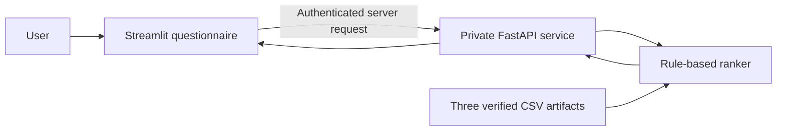

# Swan MVP — explanation and demonstration guide

Release status: deployment preparation in progress. No hosted link is claimed in this version.

## What is connected

The existing Streamlit questionnaire connects to a FastAPI service that calls Loubna's accepted rule-based moisturizer ranker. The API loads the three agreed CSVs from the versioned, checksum-verified handoff. A user receives up to three moisturizer alternatives with product IDs and explanations, or a clear scope, incomplete-answer or no-result message.

The browser communicates with Streamlit. The Streamlit server authenticates to the private API with its Cloud Run identity. Model artifacts are loaded by the API, not downloaded by the user's browser. No service-account key is shared.

## What the model does

Scope and avoidance filters run before ranking. The accepted baseline assigns +1 for the moisturising indicator and +1 for the catalogue acne-related indicator, then sorts equal scores by product code. The explanations identify supporting ingredients/indicators. This is a transparent rule-based baseline; there is no trained predictive model or demonstrated clinical effectiveness.

The current data handoff contains 50 products. Six quality-follow-up products were set aside during preparation. Product suggestions are alternatives, not a three-product routine. Ingredient concentrations are unavailable. Skin type and reactivity do not change ranking in this MVP.

## Fixes and evidence

- [PR #3](https://github.com/imanemoujahid00-oss/Swan/pull/3): shared environment, validated data loading, real API/interface integration, CI and corrected profile status spelling; merged.
- [PR #4](https://github.com/imanemoujahid00-oss/Swan/pull/4): Loubna's Python/NumPy integer-level correction, missing module import repaired, invalid values still rejected; merged.
- The `aroma` fragrance alias is corrected at load time. Source CSV bytes remain unchanged.
- The regenerated 31 synthetic profiles pass routing checks. This export is not the original file from the failing run and routing success does not establish recommendation relevance.
- Local suite after private-API client preparation: 44 tests and 29 subtests passed; two expected personalisation checks remain documented limitations. Hosted tests are still pending.

## Who checks what

| Person | Main check |
|---|---|
| Imane | Setup, automated checks, API/interface integration, deployment, service access, final URL |
| Loredana | Questionnaire semantics, scope/referral outcomes, representative profiles and functional acceptance |
| Loubna | Ranking, weights, explanations and model errors |
| Lina | Catalogue versions, ingredient mapping and data inconsistencies |

The final hosted journey is checked jointly. Someone other than the deployer should independently open the link.

## Demonstration sequence

1. Open the hosted interface from another machine/browser once available.
2. Complete an eligible adult acne-prone profile with level 2, then show real product names, IDs and reasons.
3. Explain the two ranking indicators and deterministic tie-breaking.
4. Show a scope/referral example returning no products, then fragrance avoidance.
5. Show the automated checks and explain the known personalisation/data limitations.

Do not use real personal health information for a demo; the shared profiles are synthetic. If asked what remains, distinguish deployment checks from broader data cleaning, relevance evaluation and additional outcomes planned after the MVP.

## Shared resources

- [Repository and setup](https://github.com/imanemoujahid00-oss/Swan)
- [Runtime CSV handoff](https://drive.google.com/drive/folders/1poLgGMa7S74oOVE5eY1khSEaZl6xt4PO)
- [31 synthetic profiles and routing evidence](https://drive.google.com/drive/folders/1rsq0LVXQfcCCviYCnJf8sYrG476ajCdF)
- [Project sheet](https://docs.google.com/spreadsheets/d/1OBQAgC6cJkmGy9qKlORpLAbg3JBU5QE_EfDvTT6LJig/edit)
- [Task board](https://trello.com/b/nIMWyagN/swan-team-tasks)

Hosted UI/API URLs, image digests, deployed Git commit, artifact version and hosted results will be added after verification.
